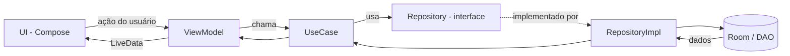
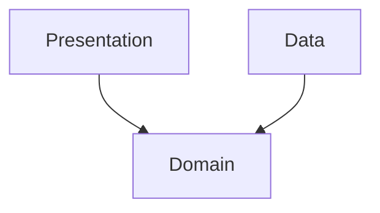

<div align="center">

# 🟠 Meus Hábitos Diários

**Aplicativo Android para criar, acompanhar e organizar seus hábitos do dia a dia.**


</div>

---

## 📱 Preview

<div align="center">
  
</div>

> 💡 Crie a pasta `screenshots/` na raiz do projeto e coloque o print do app como `home.png`.

---

## 📖 Sobre o projeto

O **Meus Hábitos Diários** é um *Habit Tracker* simples e direto: você cadastra os hábitos que quer manter, marca como concluídos e remove os que não fazem mais sentido.

Os dados ficam salvos **localmente no dispositivo** com Room, então o app funciona **100% offline**.

O projeto foi construído com foco em **boas práticas de arquitetura**, separando responsabilidades em camadas para facilitar manutenção, testes e evolução.

---

## ✨ Funcionalidades

- ✅ Adicionar novos hábitos (ex.: *Beber 2L de água*)
- ☑️ Marcar hábitos como concluídos
- 🗑️ Excluir hábitos
- 💾 Persistência local com Room (os dados não se perdem ao fechar o app)
- 🌙 Interface moderna e responsiva com Jetpack Compose

---

## 🛠️ Tecnologias

| Tecnologia | Para que serve |
|---|---|
| **Kotlin** | Linguagem principal |
| **Jetpack Compose** | Interface declarativa |
| **Clean Architecture** | Separação do projeto em camadas |
| **MVVM** | Padrão de apresentação (View ↔ ViewModel) |
| **LiveData** | Estado observável pela UI |
| **Room** | Banco de dados local (SQLite) |
| **Hilt** | Injeção de dependência |

---

## 🏗️ Arquitetura

### Analogia: um restaurante 🍽️

| Camada | No restaurante | No app |
|---|---|---|
| **Presentation** | Garçom (conversa com o cliente) | Telas Compose + ViewModel |
| **Domain** | Receitas e regras da cozinha | Entidades, UseCases e contratos |
| **Data** | Despensa (onde ficam os ingredientes) | Room, DAO e implementação do repositório |

O garçom nunca entra na despensa: ele pede para a cozinha. Da mesma forma, a **UI nunca fala direto com o banco**.

### Fluxo dos dados



### Regra de dependência



> A camada **Domain** é o centro: ela **não conhece** Android, Room nem Compose.

---

## 📂 Estrutura de pastas

> Ajuste os nomes conforme o seu projeto.

```
app/
└── src/main/java/com/seupacote/habittracker/
    ├── data/
    │   ├── local/          # Database, DAO e Entity (Room)
    │   ├── mapper/         # Entity ↔ Model
    │   └── repository/     # Implementação do repositório
    │
    ├── domain/
    │   ├── model/          # Modelos de negócio (Habit)
    │   ├── repository/     # Interface do repositório
    │   └── usecase/        # Adicionar, listar, alternar e excluir hábito
    │
    ├── presentation/
    │   ├── ui/             # Telas e componentes Compose
    │   ├── theme/          # Cores, tipografia e tema
    │   └── viewmodel/      # ViewModels com LiveData
    │
    ├── di/                 # Módulos do Hilt
    └── HabitApplication.kt # @HiltAndroidApp
```

---

## 🚀 Como executar

### Pré-requisitos

- [Android Studio](https://developer.android.com/studio) (versão estável mais recente)
- JDK 17
- Emulador ou celular Android com depuração USB

### Passo a passo

1. **Clone o repositório**
   ```bash
   git clone https://github.com/Johnrosa59/NOME-DO-REPOSITORIO.git
   ```
2. **Abra no Android Studio**
   `File` → `Open` → selecione a pasta do projeto
3. **Aguarde o Gradle sincronizar**
4. **Execute o app**
   Selecione um emulador/dispositivo e clique em ▶️ **Run**

---

## 🧠 O que eu pratiquei neste projeto

- Organização de um app Android em camadas com **Clean Architecture**
- Gerenciamento de estado com **MVVM + LiveData**
- Injeção de dependência com **Hilt**
- Persistência local com **Room**
- Construção de UI declarativa com **Jetpack Compose**

---

## 👨‍💻 Autor

**João Vitor Rosa** — Desenvolvedor Android (Kotlin/Java)

[](https://github.com/Johnrosa59)
[](https://linkedin.com/in/joaovitorrosa-dev-android)

---

<div align="center">

⭐ Se este projeto te ajudou ou inspirou, deixe uma estrela no repositório!

</div>
